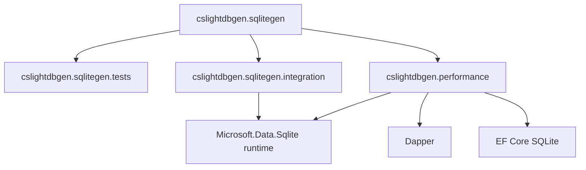

# Modules and Libraries

## Module: `src/cslightdbgen.sqlitegen`

### Responsibility

Implements the Roslyn incremental generator that emits SQLite/FTS data-access code from attributed model declarations.

### Key Files

- `GeneratorAttributes.cs`: attribute names and generated attribute source text.
- `GeneratorModel.cs`: value-equatable table/FTS/column descriptors, `JsonOptionsBinding`,
  `GenerationEnvironment`, diagnostic/location descriptions and result wrappers,
  `EquatableArray<T>` and `LdGenCategory`; enable incremental output caching without
  carrying Roslyn symbols/compilations across emission edges.
- `GeneratorConfiguration.cs`: semantic factory binding and project-wide multi-host
  environment validation; projects symbols into equatable descriptions.
- `TableSchemaPlanner.cs`: logical ordered keys, identity/composite classification and
  column constraint flags shared by all downstream key consumers.
- `JsonPersistenceEmitter.cs`: default JSON wrappers or configured per-model lazy
  options snapshot; SQL binding and concrete read shapes remain at call sites.
- `RuntimeHelpersEmitter.cs`: ordinary-output public exception in the resolved namespace,
  independently of whether a host has models.
- `GeneratorDiagnostics.cs`: registry of CSLDG001/003/005/006/007/008. CSLDG007 rejects
  a model's JSON binding; CSLDG008 rejects the host environment and suppresses ordinary
  helpers/table/FTS outputs while preserving post-init annotations. Both remain Unshipped.
- `LightSQLiteGenerator.cs`: syntax discovery, semantic analysis, and source emission.
- `cslightdbgen.sqlitegen.csproj`: analyzer packaging + Roslyn dependencies.

### Notable Internal Areas

- Syntax targets: `IsSyntaxTargetClassDec`, `IsSyntaxTargetRecordDec`
- Registration: `ForAttributeWithMetadataName` for `[LdgSQLiteTable]`; a narrow
  `CreateSyntaxProvider` for the FTS-annotated partial, then semantic projection.
  FTS source lookup combines sorted/deduplicated local and referenced table names;
  table emission wins for dual-annotated models.
- Environment: `ParseOptionsProvider` projects `CSLIGHTDBGEN_MULTI_HOST`, combined with
  compilation validation before equatable helper names reach emission. Extraction
  tracking (`LdgTableModel`/`LdgFtsModel`) is distinct from environment/effective
  emission tracking.
- Bootstrap: fixed post-init annotations/FK enum are public by default, internal in
  local mode. Public runtime exception output is separate; local hosts choose distinct
  namespaces with no default alias.
- Emission entry points: `emit(...)` (regular tables) and `emitFts(...)` (FTS virtual tables)
- Table generation path: CRUD/select/filter + extension methods
- FTS generation path: virtual-table creation, populate, select, count
- Type handling: nullable/scalar/enum/JSON collection serialization support

## Module: `tests/cslightdbgen.sqlitegen.tests`

### Responsibility

Unit-level verification of generation contracts and syntax behavior.

### Key Files

- `TestInfrastructure/GeneratorTestHost.cs`
  - Creates in-memory `CSharpCompilation`
  - Executes generator driver
  - Exposes generated source map and diagnostics
- `TestFixtures/FixtureSources.cs`
  - Source snippets for model scenarios (table/index/json/record/inheritance/fts)
- `LightSQLiteGenerator_SyntaxTests.cs`
  - Verifies syntax target detection for class/record paths
- `LightSQLiteGenerator_GenerationTests.cs`
  - Verifies generated source content and compile diagnostics
- `LightSQLiteGenerator_FilterParityTests.cs`
  - Verifies generated filter signatures/options
- `LightSQLiteGenerator_FtsTests.cs`
  - Verifies FTS generation specifics
- `LdgSQLiteUtils_Tests.cs` + `LdgSQLiteUtilsFixture.cs`
  - Tests helper parity for serialization/parsing/html stripping logic
- The suite has since grown to over 20 focused test files. Beyond those listed above it covers composite keys, column defaults, CSLDG diagnostics, `EnsureSchema`, enums, foreign keys, multi-select (`IN`/`NOT IN`) filters, ordering, `RETURNING` writes, transactions, unique/partial indexes, `Upsert`, reserved-word quoting, cross-project usage, and incremental caching. KeyNoUnique and JsonOptions tests pin the opt-in policies; CrossProject tests compile independent emitted images including a pure non-analyzer third consumer. The entries above are representative, not exhaustive.

## Module: `tests/cslightdbgen.sqlitegen.integration`

### Responsibility

Integration verification of generated code behavior against in-memory SQLite.

### Key Files

- `IntegrationModels.cs`: real attributed models compiled with analyzer-generated members.
- `LightSQLiteGenerator_IntegrationTests.cs`: end-to-end tests for:
  - table CRUD lifecycle,
  - record model lifecycle,
  - FTS create/populate/search lifecycle.

### Why It Matters

Confirms generated source compiles and executes correctly with actual SQL runtime behavior, beyond string-based generation assertions.

### Real Analyzer-Host Fixtures

`tests/cslightdbgen.sqlitegen.integration.host-a` and `.host-b` are non-test,
non-packable libraries targeting net11.0/net10.0 with no packages. Both run the
generator as an analyzer in local mode, using distinct public runtime namespaces.
B references A ordinarily and inherits its internally annotated base/key metadata;
B uses local annotations/FK enum and an FTS projection of A's known table.

The default-mode integration assembly ordinarily references both and executes both
DALs against real SQLite, catches the exact public exceptions, reflects internal
annotation metadata and verifies no consumer references/loads the generator at runtime.
This qualifies the supported one-way A/B/C graph, not mixed/friend configurations
or a downstream FHIR/API/ABI migration.

## Module: `tests/cslightdbgen.performance`

### Responsibility

Benchmark harness for comparative performance evaluation.

### Key Files

- `Program.cs`: benchmark switcher entrypoint
- `Benchmarks.cs`: benchmark scenarios and data setup

### Compared Paths

- Generated API (`SqliteGen`)
- Dapper direct SQL
- Dapper `SqlBuilder`
- Entity Framework Core (SQLite provider)

### Scenarios

- single insert
- bulk insert
- single row select
- filtered multi-row select
- unfiltered multi-row select

## Module Relationships

The generator module is the producer. Tests and benchmark projects are consumers that compile with analyzer output and validate functionality/performance.
