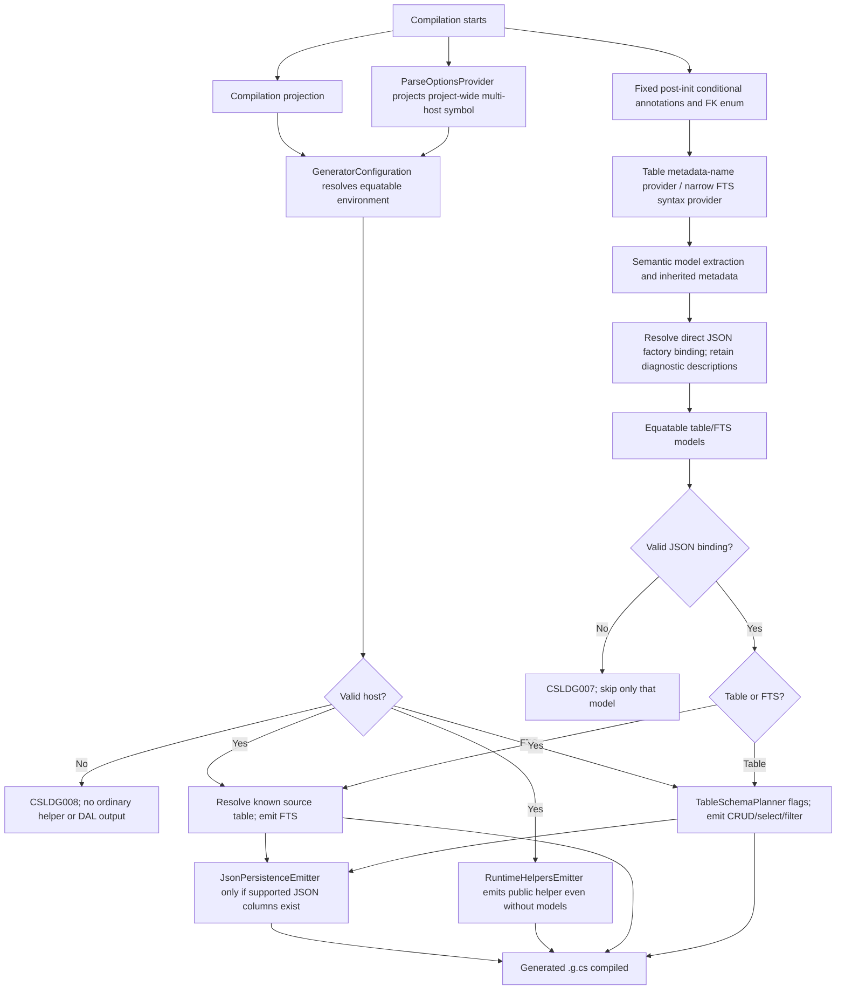
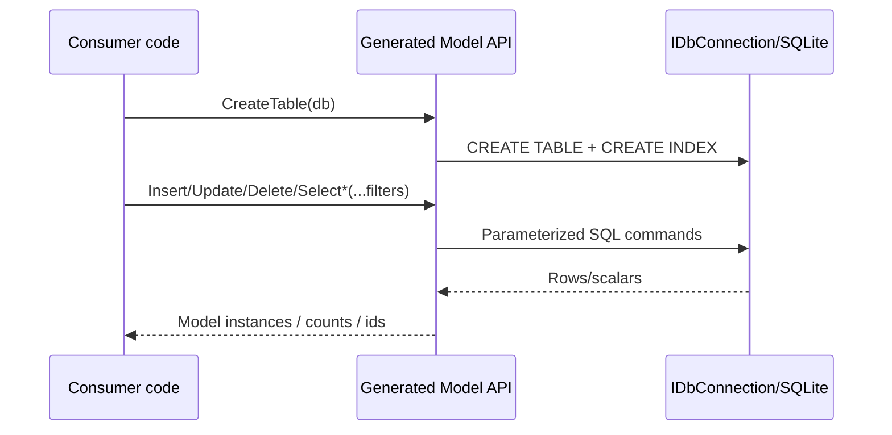
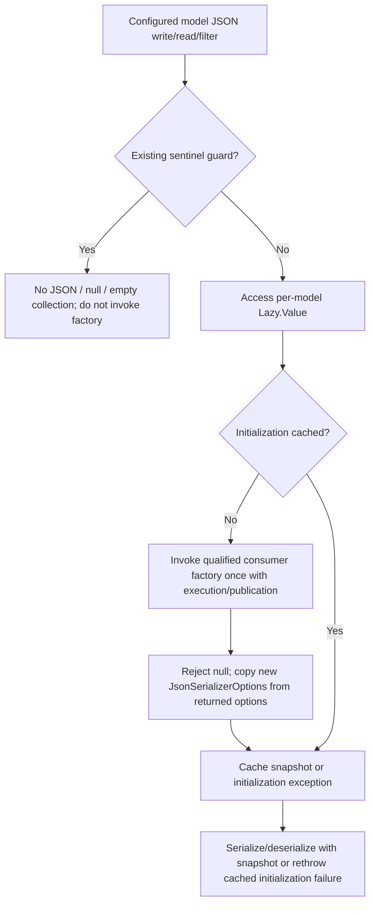
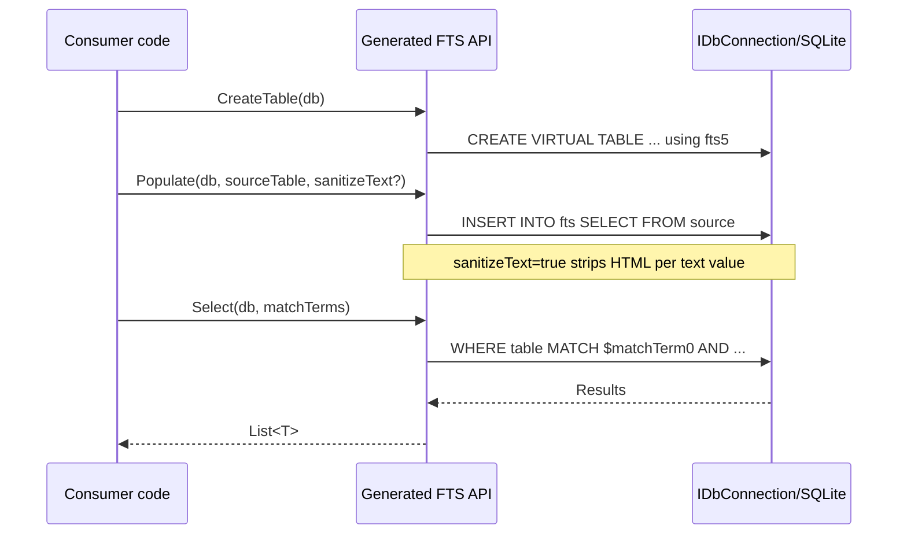
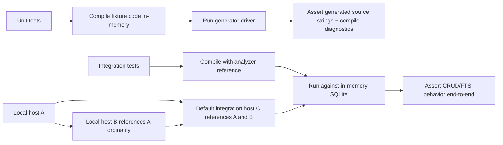
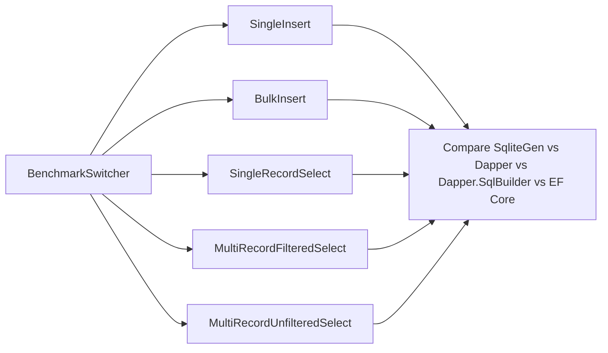

# Process Flows

## 1) Generation Flow (Build-Time)

### Trigger Conditions

A class/record is generated from a table/FTS annotation:

- `LdgSQLiteTable`
- `LdgSQLiteFtsTable`
- `LdgSQLiteBaseClass` marks inherited-member metadata; it is not itself a DAL target.

Regular tables use `ForAttributeWithMetadataName`. FTS uses the existing narrow
`CreateSyntaxProvider` spelling predicate on the FTS-annotated partial followed by
semantic projection, not a second metadata-name provider. Table wins for a
dual-annotated model. FTS source lookup combines sorted/deduplicated local and
referenced table names (unknown source: CSLDG006).

`GeneratorConfiguration` alone inspects factory/host symbols. `GeneratorModel` values
carry binding, environment and diagnostic/location descriptions; no compilation,
symbol, raw location, delegate or mutable collection reaches emission.
`TableSchemaPlanner` returns key/constraint flags, not SQL; `JsonPersistenceEmitter`
and `RuntimeHelpersEmitter` consume validated policy without interpreting attributes.
SQL templates/quoting remain in `LightSQLiteGenerator`.

Value equality separates model extraction (`LdgTableModel`, `LdgFtsModel`) from
environment/effective output (`LdgEnvironment`, `LdgRuntimeEmission`,
`LdgTableEmission`, `LdgFtsEmission`). Unrelated/factory-body edits can rerun semantic
projection without changing effective outputs; a model's JSON selection changes only
its binding/output, while helper namespace/symbol changes invalidate dependent output.

## 2) Runtime CRUD Flow (Generated Table Models)

### Key Behavior

- Insert overloads: single value, `List<T>`, `IEnumerable<T>`.
- Select overloads: single, list, enumerable, dictionary, count.
- Filter model generated per property:
  - equality and optional `LIKE` for strings,
  - numeric operator switch (`=`, `!=`, `>`, `>=`, `<`, `<=` and named aliases),
  - nullable tri-state (`PropertyIsNull == true/false/null`),
  - `PropertyValues` list for `IN (...)` and `PropertyNotInValues` list for `NOT IN (...)`, generated for any `[LdgSQLiteMultiSelect]` property, the primary key, or (legacy heuristic) a `*Key`-style column.
- Additional runtime paths beyond basic CRUD: `EnsureSchema` (additive, non-destructive migration), `Upsert` (`INSERT … ON CONFLICT`), and `InsertReturning`/`UpdateReturning` (write plus `RETURNING` hydration in a single round-trip).

### Shared Key Planning

`TableSchemaPlanner.Plan` collects all old/new keys in property order, then classifies
single/composite and identity before assigning per-column constraints. Old single keys
retain `UNIQUE PRIMARY KEY NOT NULL`; new `LdgSQLiteKeyNoUnique` singles get `PRIMARY KEY`
without injected UNIQUE/NOT NULL (including the CLR-nullability branch). Composites use
all members with one table-level PK and no identity. Old composite members retain their
actual CLR-nullability behavior; new members suppress injected NOT NULL even when CLR
nonnullable. Explicit property/class/index uniqueness remains effective.

The same logical plan drives insert exclusions/hydration, full-key predicates,
filters, dictionary eligibility, Upsert targets and EnsureSchema key exclusion.
Identity/counters remain unchanged; `AutoIncrement = false` is supported. Both
annotations on one property report CSLDG005; explicit composite auto-increment reports
CSLDG003. For new metadata-only attributes, bare versus explicit constructor `true`
cannot be distinguished; named-property requests remain observable.

SQLite inherent PK uniqueness/INTEGER rowid behavior persists. Raw SQL NULLs in
text/composite keys do not gain NULL-safe CLR readers/predicates/dictionaries.
EnsureSchema never rebuilds/removes/repairs key constraints when annotations change.

### JSON First-Use Flow

Schema/counter/metadata operations never access the lazy value. Valid scalar-only
configuration is validated but emits no helper. Failure is visible without fallback,
retry or model initializer poisoning. Copying is shallow: converters are shared and
must be thread-safe; do not mutate returned options concurrently while copied. The
original stays independently mutable; serializer use freezes the snapshot.

Direct table/FTS annotations select all model JSON columns, including inherited ones;
base/source policies do not flow implicitly. Null writes/empty List writes bind SQL
NULL if nullable and empty text otherwise; empty arrays/enumerables take the generic
serializer path. Nullable SQL NULL bypasses parsing. Empty/whitespace text returns
null objects (nonnullable fallback `new T()`) or empty collections without invoking
the factory; JSON `null` text invokes deserialization then uses those fallbacks if
the deserializer returns null.
Collection reads use `List<T>` and arrays call `ToArray()`, so array-specific converters
are not promised symmetric behavior. Null equality filters omit the condition; `IsNull`
is explicit. See the [complete matrix](api-contracts.md#null--empty--storage-matrix).

## 3) Runtime FTS Flow (Generated FTS Models)

## 4) Test Flow

The real A/B libraries target all three test frameworks without runtime packages.
Each appends project-wide `CSLIGHTDBGEN_MULTI_HOST` and chooses a distinct assembly
runtime namespace. Post-init annotations/FK enum become internal; ordinary-output
exceptions stay public with no default alias. C exercises inherited internal metadata,
local FK enum actions and FTS source discovery, catches exact A/B exceptions on stale
updates/deletes, and checks visibility plus the actual generator assembly name's absence
from runtime references/loaded dependencies. The existing default stale-key regression
remains separate and unchanged. Unit tests additionally emit independent assembly
images for a non-analyzer C and inspect compile/image-emit diagnostics.

Namespace validation/collisions report CSLDG008; adopting/changing the namespace
requires explicit public catch/type-reference review. The one-way A/B/C graph requires
no consolidation, suppression, `extern alias` or friend access. Mixed default/local
annotation hosts and friend exposure are not guaranteed warning-free; default
two-host duplicate-public-type behavior is intentionally retained.

## 5) Benchmark Flow

Benchmark outputs are written under `BenchmarkDotNet.Artifacts/results`.
